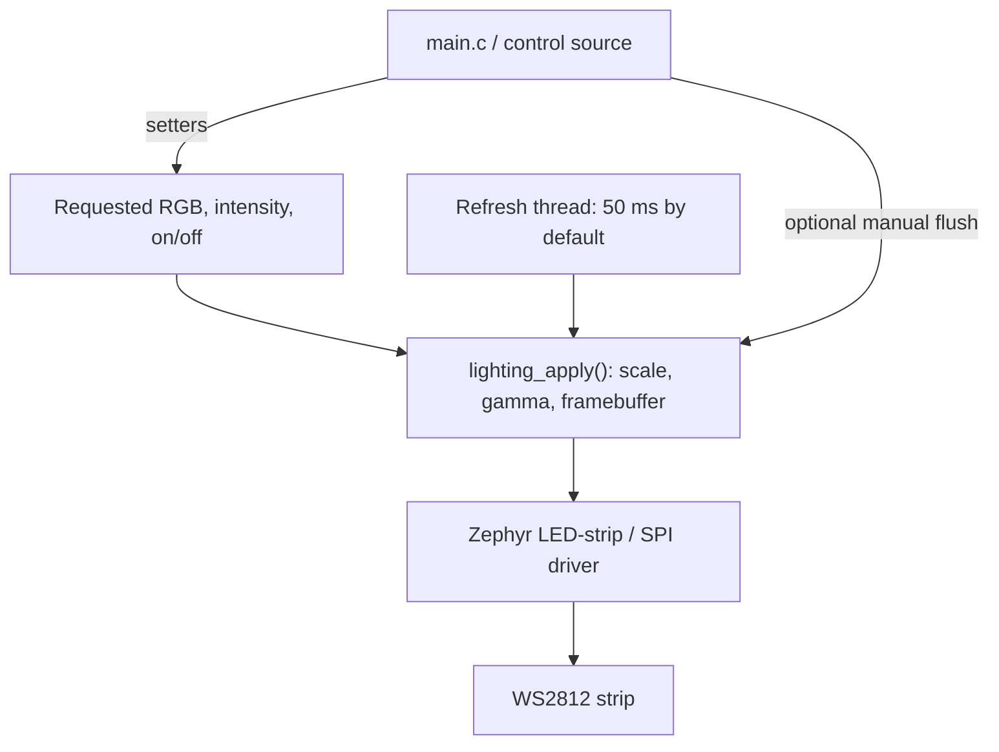

# Meshlight

Meshlight is Zephyr-based firmware that controls a WS2812 RGB LED strip on a
Nordic or STM32 board. Each board connects to a Bluetooth Mesh network, where
you can change the color, brightness, and power of individual LEDs or the whole
strip from a phone.

You can use the AI-generated [Meshlight Android app](android-app/) to add and control lights.

## The project's purpose

I wanted to learn about BLE mesh. So I decided to define and start a project and why not to share it online. 

Keep in mind that this project was a playground for me to learn BLE mesh. Although I tried my best to keep everything clean, but still some parts might not work ideally. 

## AI usage

Why not to use AI in the aga of AI?
I used AI in the whole developemnt phase, specially in the unit tests and ci topics but with reviewing the output. 
The Android app is fully vibe coded because it was not the main goal of the project and also is not my expertise. 

## What it does

- Controls individual LEDs or the whole strip using RGB values and 0–100% intensity.
- Uses one mesh element for 1–339 LEDs; exposes LED count and control capabilities.
- Enables Relay and GATT Proxy by default, configurable through Kconfig and mesh.
- Factory-resets with app Node Reset or a button-0 hold longer than 30 seconds.
- Applies gamma 2.2 through an integer lookup pipeline, without runtime floating point.
- Refreshes output in a dedicated Zephyr thread every 50 ms by default (20 Hz).
- Preserves selected colors and intensities while the strip is off.
- Restores lighting from CRC-protected Settings and saves actual changes in the background.
- Provides an optional developer UART shell for manual control.
- Serializes state updates and transfers with a mutex, using static storage.
- Builds the same application for four boards with nRF Connect SDK **3.3.0**.

### BLE mesh behavior

On boot, the application initializes Bluetooth Mesh and loads its saved settings.
If provisioning was restored, the node resumes its existing mesh membership and
configuration. Otherwise, it enables both advertising and GATT provisioning
bearers and can be provisioned using No OOB authentication. Its device UUID is
derived from the hardware identity and remains stable across resets and firmware
updates. Relay and GATT Proxy are enabled by default; saved mesh configuration
is restored on ordinary reboots.

Provisioning assigns the node to a network, but a controller must also add an
Application Key and bind it to the lighting models before controlling them.
See the [mesh setup and protocol guide](docs/04-mesh.md) for provisioning,
configuration, and factory reset instructions. If settings or reset recovery
fails, normal mesh startup stops rather than provisioning with lost keys.

## Supported hardware

| Board | Zephyr build target | Strip data output | Default I/O voltage |
| --- | --- | --- | --- |
| nRF54L15-DK | `nrf54l15dk/nrf54l15/cpuapp` | GPIO P1.12, PORT P1 physical position 15 | 1.8 V |
| nRF52-DK (PCA10040 / nRF52832) | `nrf52dk/nrf52832` | GPIO P0.23 / Arduino D11 | 3 V |
| nRF5340-DK (PCA10095) | `nrf5340dk/nrf5340/cpuapp` | GPIO P1.13 / Arduino D11 | 3 V |
| NUCLEO-WB55RG | `nucleo_wb55rg` | PA7 / Arduino D11 / CN5 pin 4 | 3.3 V |

## Quick start

First complete [SDK and workspace setup](docs/00-setup.md#2-prepare-the-workspace).
Then, from the repository root in an SDK 3.3.0 terminal, build and flash one board:

```sh
# nRF54L15-DK
west build --no-sysbuild -b nrf54l15dk/nrf54l15/cpuapp -d build/dk firmware
west flash -d build/dk
```

```sh
# nRF52-DK (nRF52832)
west build --no-sysbuild -b nrf52dk/nrf52832 -d build/nrf52dk firmware
west flash -d build/nrf52dk
```

```sh
# nRF5340-DK: sysbuild includes the Bluetooth network-core firmware
west build --sysbuild -b nrf5340dk/nrf5340/cpuapp -d build/nrf5340dk firmware
west flash -d build/nrf5340dk
```

```sh
# NUCLEO-WB55RG, using this repository's west workspace
west build --no-sysbuild -b nucleo_wb55rg -d build/wb55 firmware
west flash -d build/wb55
```

## How to change configurations

### Change number of LEDs

Open the [board overlay](firmware/boards/) for your target and change
`chain-length` to match the number of LEDs on the strip. For example:

```dts
chain-length = <17>;
```

The default is six LEDs. The firmware supports 1 to 339 LEDs, subject to the
board's available memory; the nRF52 production build is checked with 128 LEDs
and its developer-shell build with six. Rebuild and flash using the commands
in [Quick start](#quick-start). When the count changes, saved settings for
matching LED indices are restored, new LEDs start white at 50% intensity, and
extra saved entries are ignored. See [configure the strip](docs/00-setup.md#5-configure-the-strip)
for board-specific limits, color order, and pin settings.

### Enable developer shell

The UART shell is disabled by default. Build with the supplied configuration
fragment in a separate build directory, then flash it. For example, for the
nRF54L15-DK:

```sh
west build --no-sysbuild -b nrf54l15dk/nrf54l15/cpuapp -d build/dk-dev firmware -- "-DEXTRA_CONF_FILE=dev_shell.conf"
west flash -d build/dk-dev
```

For other boards, use their Quick start board target and sysbuild option. An
existing Nordic SDK workspace needs the [additional STM32 HAL module](docs/00-setup.md#22-use-an-existing-nordic-sdk-workspace)
for the Nucleo build. Connect a serial terminal to the onboard debugger's virtual
COM port at **115200 baud, 8N1, with no flow control**, then try `lighting show`.
See the [developer shell guide](docs/02-lighting.md#4-developer-uart-shell) for the
available commands and examples.

### Change strip color order or data pin

In the target's [board overlay](firmware/boards/), set `color-mapping` to the
strip's wire order; the default is GRB. Lighting commands still use RGB values.
To change the data pin, update the board's pin configuration; Nordic overlays
have both default and sleep pinctrl groups. Rebuild and flash after editing the
overlay. Check the board-specific pin restrictions and signal timing in
[configure the strip](docs/00-setup.md#5-configure-the-strip).

### Adjust refresh and save timing

Build-time application options are defined in [firmware/Kconfig](firmware/Kconfig).
For example, create `firmware/custom.conf` with the settings you want to change:

```ini
CONFIG_LIGHTING_REFRESH_INTERVAL_MS=100
CONFIG_LIGHTING_SAVE_DELAY_MS=2000
```

Add the fragment to a build using the same `EXTRA_CONF_FILE` argument shown for
the developer shell, replacing `dev_shell.conf` with `custom.conf`. Rebuild and
flash the resulting firmware. The defaults are a 50 ms refresh interval and a
1000 ms quiet period before saving color and intensity changes. The failed-save
retry delay and worker stack sizes are also configurable. Disabling automatic
refresh requires application code to call `lighting_apply()`; the default
application relies on automatic refresh. See [refresh configuration](docs/02-lighting.md#5-refresh-configuration)
and [persistent settings](docs/03-storage.md) for details.

### Configure Bluetooth Mesh

Relay and GATT Proxy support and their initial states can be changed with
`CONFIG_BT_MESH_RELAY`, `CONFIG_BT_MESH_RELAY_ENABLED`,
`CONFIG_BT_MESH_GATT_PROXY`, and `CONFIG_BT_MESH_GATT_PROXY_ENABLED` in a build
configuration fragment. A provisioner can also configure supported features,
model bindings, subscriptions, and publication. Saved mesh configuration takes
precedence over build-time initial-state defaults on ordinary reboots; factory
reset restores the build defaults.

The vendor model's company and model identifiers are set with
`CONFIG_MESHLIGHT_COMPANY_ID` and `CONFIG_MESHLIGHT_MODEL_ID`. The default
company ID `0xFFFF` is a development placeholder; assign the project's company
ID before distribution. See [Bluetooth Mesh control](docs/04-mesh.md) for setup and
protocol details.

## How it is organized

Firmware sources are grouped by module:

```text
firmware/src/
  main.c
  lighting/
    CMakeLists.txt
    lighting.h             Public lighting API
    lighting.c             State, rendering, refresh, and persistence scheduling
    lighting_settings.c/.h Private CBOR encoding
    lighting_shell.c       Optional developer commands
    lighting_gamma_table.h Private lookup table
  storage/
    CMakeLists.txt
    storage.h              Public storage API
    storage.c              Zephyr Settings backend access
  mesh/                    Provisioning, models, protocol, and platform support
  device_control/          Button hold detection and journaled factory reset
```

Each module owns its source list. Include public interfaces as
`"lighting/lighting.h"` and `"storage/storage.h"` using the shared `src` include
root; implementation headers stay beside their module. Production builds and
tests reuse the same module CMake files.



Setters store requests; the next refresh renders the latest state. A successful
setter confirms storage. `lighting_apply()` provides a synchronous transfer when
needed. The [lighting API guide](docs/02-lighting.md) explains the calls, error handling,
threading contract, and refresh options.

| Location | Responsibility |
| --- | --- |
| [firmware/src/main.c](firmware/src/main.c) | Startup, version logging, and restored lighting |
| [firmware/src/lighting/lighting.h](firmware/src/lighting/lighting.h) | Public lighting interface and API contracts |
| [firmware/src/lighting/lighting.c](firmware/src/lighting/lighting.c) | Requested state, rendering, locking, and refresh scheduling |
| [firmware/src/storage/](firmware/src/storage/) | Shared Settings storage interface and implementation |
| [firmware/boards/](firmware/boards/) | Pins, SPI encoding, LED count, and color order |
| [firmware/tests/](firmware/tests/) | Production-module tests with fake strip devices |
| [scripts/](scripts/) and [.github/](.github/) | Version resolution, CI validation, packaging, and releases |
| [west.yml](west.yml) | Pinned SDK and STM32 HAL dependencies |

## Testing and releases

The firmware tests cover rendering, persistence/shell behavior, ZMS/NVS storage,
reset recovery, model transactions/transitions, protocol validation, and
1/6/17/300/339-LED configurations. CI discovers all test scenarios, builds all
products with and without the shell, and runs the tests in QEMU. Python tests also cover versioning, packaging, report validation, and
release publication using a mocked GitHub interface.

See [testing](docs/05-testing.md) for commands, coverage, and hardware limitations.

Versions come from Git history: `master` produces alpha builds, `release/x.y.z`
produces beta builds, and a `vx.y.z` tag triggers a final GitHub Release after
validation. See [versioning and CI](docs/06-ci.md) for downloads and release steps.

## Project status

Mesh control and No-OOB provisioning are implemented. Physical phone/radio,
reset, and relay acceptance checks are documented separately from emulator
results. A custom controller UI, OOB authentication, and animation streaming
are future work. Gamma 2.2 is fixed, and small nonzero values
can round to black with eight-bit output.

## License

Licensed under the [MIT License](LICENSE). SDK and other third-party dependencies
retain their own licenses.
