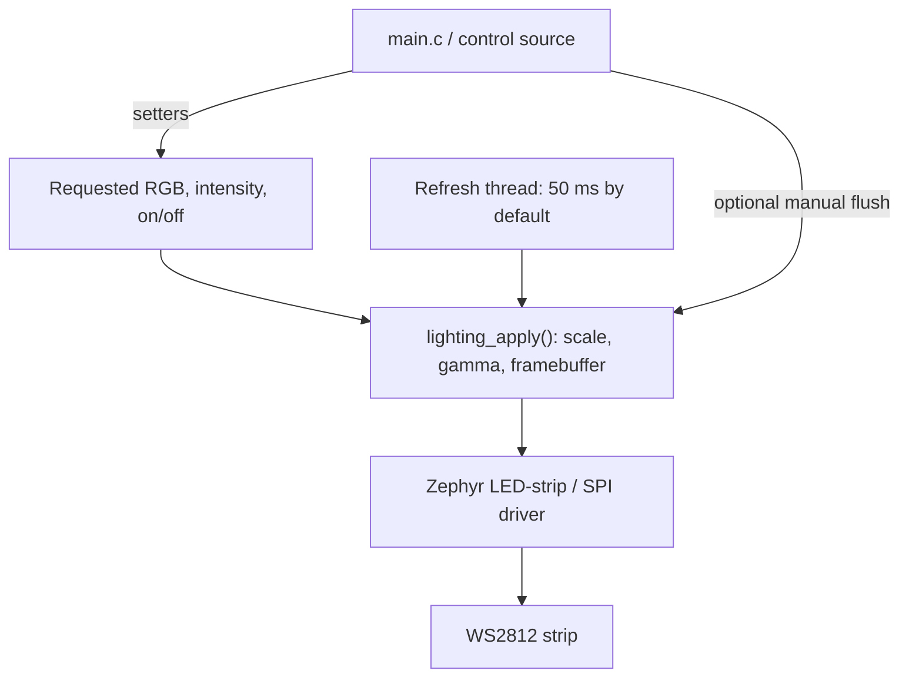

# Meshlight

Portable Zephyr firmware for controlling a WS2812 RGB LED strip on Nordic and
STM32 boards. A shared C module provides per-LED color and intensity, gamma
correction, and automatic refresh, with hardware configuration kept in devicetree
overlays.

**Current scope:** a Bluetooth Mesh lighting node with persistent settings,
individual LED control, and an optional developer UART shell. Use nRF Mesh for
provisioning, native power/intensity controls, and raw vendor RGB messages.
See the [mesh setup and protocol guide](docs/mesh.md).

## What it does

- Controls individual LEDs or the whole strip using RGB values and 0–100% intensity.
- Uses one mesh element for 1–339 LEDs; exposes LED count and control capabilities.
- Enables Relay and GATT Proxy by default, configurable through Kconfig and mesh.
- Factory-resets with app Node Reset or a button-0 hold longer than 30 seconds.
- Applies gamma 2.2 through an integer lookup pipeline, without runtime floating point.
- Refreshes output in a dedicated Zephyr thread every 50 ms by default (20 Hz).
- Preserves selected colors and intensities while the strip is off.
- Restores lighting from CRC-protected Settings and saves actual changes in the background.
- Provides an optional developer UART shell for manual control.
- Serializes state updates and transfers with a mutex, using static storage.
- Builds the same application for four boards with nRF Connect SDK **3.3.0**.

On boot, the application restores the last saved colors and intensities and
always selects power on. With no valid snapshot it starts white at 50% intensity
and waits for control input. Color/intensity changes save automatically after
one second without further edits; continuous edits postpone saving until they stop.
Power changes are runtime-only.
See [persistent settings and developer shell](docs/storage.md) for flash layout,
API contracts, shell commands, and manual retention checks.

## Supported hardware

The default configuration is **six LEDs in GRB wire order**. The application API
always accepts ordinary RGB channels.

| Board | Zephyr build target | Strip data output | Default I/O voltage |
| --- | --- | --- | --- |
| nRF54L15-DK | `nrf54l15dk/nrf54l15/cpuapp` | GPIO P1.12, PORT P1 physical position 15 | 1.8 V |
| nRF52-DK (PCA10040 / nRF52832) | `nrf52dk/nrf52832` | GPIO P0.23 / Arduino D11 | 3 V |
| nRF5340-DK (PCA10095) | `nrf5340dk/nrf5340/cpuapp` | GPIO P1.13 / Arduino D11 | 3 V |
| NUCLEO-WB55RG | `nucleo_wb55rg` | PA7 / Arduino D11 / CN5 pin 4 | 3.3 V |

For a 5 V strip, use a suitable level shifter, a strip power supply, and a common
ground. Follow [setup and wiring](docs/setup.md) before connecting hardware.
Board configurations are checked by builds; visible output and
signal timing still require [physical validation](docs/testing.md#physical-checks).

## Quick start

First complete [SDK and workspace setup](docs/setup.md#prepare-the-workspace).
Then, from the repository root in an SDK 3.3.0 terminal, build and flash one board:

```sh
# nRF54L15-DK
west build --no-sysbuild -b nrf54l15dk/nrf54l15/cpuapp -d build/dk firmware
west flash -d build/dk
```

```sh
# nRF52-DK (nRF52832)
west build --no-sysbuild -b nrf52dk/nrf52832 -d build/nrf52dk firmware
west flash -d build/nrf52dk
```

```sh
# nRF5340-DK: sysbuild includes the Bluetooth network-core firmware
west build --sysbuild -b nrf5340dk/nrf5340/cpuapp -d build/nrf5340dk firmware
west flash -d build/nrf5340dk
```

```sh
# NUCLEO-WB55RG, using this repository's west workspace
west build --no-sysbuild -b nucleo_wb55rg -d build/wb55 firmware
west flash -d build/wb55
```

An existing Nordic SDK workspace needs an additional STM32 HAL module for the
Nucleo build; follow the [existing SDK instructions](docs/setup.md#use-an-existing-nordic-sdk-workspace).
Use separate build directories for each board. Change `chain-length` in its
[board overlay](firmware/boards/) to match the actual strip length, then rebuild.

## How it is organized

Firmware sources are grouped by module:

```text
firmware/src/
  main.c
  lighting/
    CMakeLists.txt
    lighting.h             Public lighting API
    lighting.c             State, rendering, refresh, and persistence scheduling
    lighting_settings.c/.h Private CBOR encoding
    lighting_shell.c       Optional developer commands
    lighting_gamma_table.h Private lookup table
  storage/
    CMakeLists.txt
    storage.h              Public storage API
    storage.c              Zephyr Settings backend access
  mesh/                    Provisioning, models, protocol, and platform support
  device_control/          Button hold detection and journaled factory reset
```

Each module owns its source list. Include public interfaces as
`"lighting/lighting.h"` and `"storage/storage.h"` using the shared `src` include
root; implementation headers stay beside their module. Production builds and
tests reuse the same module CMake files.



Setters store requests; the next refresh renders the latest state. A successful
setter confirms storage. `lighting_apply()` provides a synchronous transfer when
needed. The [lighting API guide](docs/lighting.md) explains the calls, error handling,
threading contract, and refresh options.

| Location | Responsibility |
| --- | --- |
| [firmware/src/main.c](firmware/src/main.c) | Startup, version logging, and restored lighting |
| [firmware/src/lighting/lighting.h](firmware/src/lighting/lighting.h) | Public lighting interface and API contracts |
| [firmware/src/lighting/lighting.c](firmware/src/lighting/lighting.c) | Requested state, rendering, locking, and refresh scheduling |
| [firmware/src/storage/](firmware/src/storage/) | Shared Settings storage interface and implementation |
| [firmware/boards/](firmware/boards/) | Pins, SPI encoding, LED count, and color order |
| [firmware/tests/](firmware/tests/) | Production-module tests with fake strip devices |
| [scripts/](scripts/) and [.github/](.github/) | Version resolution, CI validation, packaging, and releases |
| [west.yml](west.yml) | Pinned SDK and STM32 HAL dependencies |

## Testing and releases

The firmware tests cover rendering, persistence/shell behavior, ZMS/NVS storage,
reset recovery, model transactions/transitions, protocol validation, and
1/6/17/300/339-LED configurations. CI discovers all test scenarios, builds all
products with and without the shell, and runs the tests in QEMU. Python tests also cover versioning, packaging, report validation, and
release publication using a mocked GitHub interface.

See [testing](docs/testing.md) for commands and coverage, and the
[validation record](docs/validation.md) for dated results and hardware limitations.

Versions come from Git history: `master` produces alpha builds, `release/x.y.z`
produces beta builds, and a `vx.y.z` tag triggers a final GitHub Release after
validation. See [versioning and CI](docs/ci.md) for downloads and release steps.

## Project status

Mesh control and No-OOB provisioning are implemented. Physical phone/radio,
reset, and relay acceptance checks are documented separately from emulator
results. A custom controller UI, OOB authentication, and animation streaming
are future work. Gamma 2.2 is fixed, and small nonzero values
can round to black with eight-bit output.

## License

Licensed under the [MIT License](LICENSE). SDK and other third-party dependencies
retain their own licenses.
