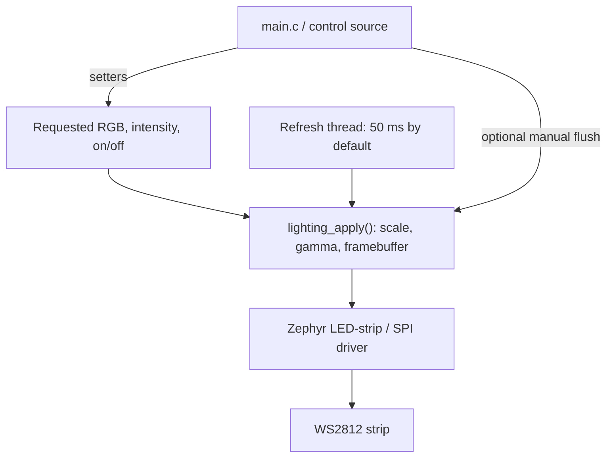

# Meshlight

Portable Zephyr firmware for controlling a WS2812 RGB LED strip on Nordic and
STM32 boards. A shared C module provides per-LED color and intensity, gamma
correction, and automatic refresh, with hardware configuration kept in devicetree
overlays.

**Current scope:** a standalone lighting controller and demonstration application.
Bluetooth Mesh messaging and Android control are planned; neither is implemented.

## What it does

- Controls individual LEDs or the whole strip using RGB values and 0–100% intensity.
- Applies gamma 2.2 through an integer lookup pipeline, without runtime floating point.
- Refreshes output in a dedicated Zephyr thread every 50 ms by default (20 Hz).
- Preserves selected colors and intensities while the strip is off.
- Serializes state updates and transfers with a mutex, using static storage.
- Builds the same application for two boards with nRF Connect SDK **3.3.0**.

On boot, the application clears the strip, selects red at 10% intensity, and
enables output. All LEDs then pulse between 10% and 100% intensity, advancing
through red, yellow, green, cyan, blue, and magenta at each dim endpoint.
The demo updates requests every 50 ms; output refresh runs independently.

## Supported hardware

The default configuration is **six LEDs in GRB wire order**. The application API
always accepts ordinary RGB channels.

| Board | Zephyr build target | Strip data output | Default I/O voltage |
| --- | --- | --- | --- |
| nRF54L15-DK | `nrf54l15dk/nrf54l15/cpuapp` | GPIO P1.12, PORT P1 physical position 15 | 1.8 V |
| NUCLEO-WB55RG | `nucleo_wb55rg` | PA7 / Arduino D11 / CN5 pin 4 | 3.3 V |

For a 5 V strip, use a suitable level shifter, a strip power supply, and a common
ground. Follow [setup and wiring](docs/setup.md) before connecting hardware.
Both board configurations have recorded successful builds; visible output and
signal timing still require [physical validation](docs/testing.md#physical-checks).

## Quick start

First complete [SDK and workspace setup](docs/setup.md#prepare-the-workspace).
Then, from the repository root in an SDK 3.3.0 terminal, build and flash one board:

```sh
# nRF54L15-DK
west build --no-sysbuild -b nrf54l15dk/nrf54l15/cpuapp -d build/dk firmware
west flash -d build/dk
```

```sh
# NUCLEO-WB55RG, using this repository's west workspace
west build --no-sysbuild -b nucleo_wb55rg -d build/wb55 firmware
west flash -d build/wb55
```

An existing Nordic SDK workspace needs an additional STM32 HAL module for the
Nucleo build; follow the [existing SDK instructions](docs/setup.md#use-an-existing-nordic-sdk-workspace).
Use separate build directories for each board. Change `chain-length` in its
[board overlay](firmware/boards/) to match the actual strip length, then rebuild.

## How it is organized



Setters store requests; the next refresh renders the latest state. A successful
setter confirms storage. `lighting_apply()` provides a synchronous transfer when
needed. The [lighting API guide](docs/lighting.md) explains the calls, error handling,
threading contract, and refresh options.

| Location | Responsibility |
| --- | --- |
| [firmware/src/main.c](firmware/src/main.c) | Startup, version logging, and the demonstration loop |
| [firmware/src/lighting.h](firmware/src/lighting.h) | Public lighting interface and API contracts |
| [firmware/src/lighting.c](firmware/src/lighting.c) | Requested state, rendering, locking, and refresh scheduling |
| [firmware/boards/](firmware/boards/) | Pins, SPI encoding, LED count, and color order |
| [firmware/tests/](firmware/tests/) | Production-module tests with fake strip devices |
| [scripts/](scripts/) and [.github/](.github/) | Version resolution, CI validation, packaging, and releases |
| [west.yml](west.yml) | Pinned SDK and STM32 HAL dependencies |

## Testing and releases

The firmware test inventory contains **76 cases across five scenarios**:
20 manual-mode cases for each of 1, 6, and 17 LEDs, plus eight automatic-refresh
cases at each of 50 ms and 20 ms. CI builds both products and runs these scenarios
in QEMU. Python tests also cover versioning, packaging, report validation, and
release publication using a mocked GitHub interface.

See [testing](docs/testing.md) for commands and coverage, and the
[validation record](docs/validation.md) for dated results and hardware limitations.

Versions come from Git history: `master` produces alpha builds, `release/x.y.z`
produces beta builds, and a `vx.y.z` tag triggers a final GitHub Release after
validation. See [versioning and CI](docs/ci.md) for downloads and release steps.

## Project status

Persistence, network transport, provisioning, and interactive controls are future
work. The current demo continuously writes lighting state; replace its loop when
integrating another control source. Gamma 2.2 is fixed, and small nonzero values
can round to black with eight-bit output.

## License

Licensed under the [MIT License](LICENSE). SDK and other third-party dependencies
retain their own licenses.
