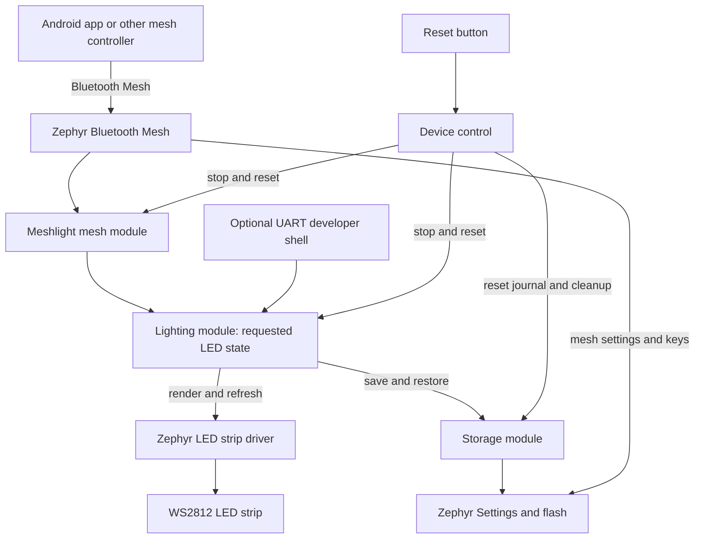
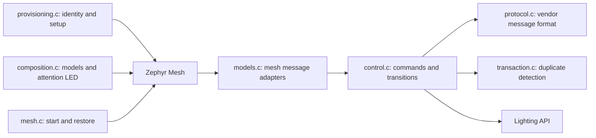
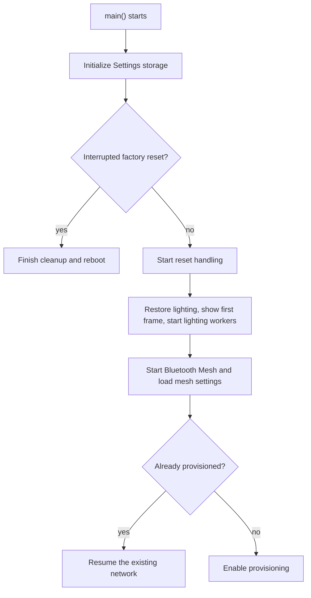
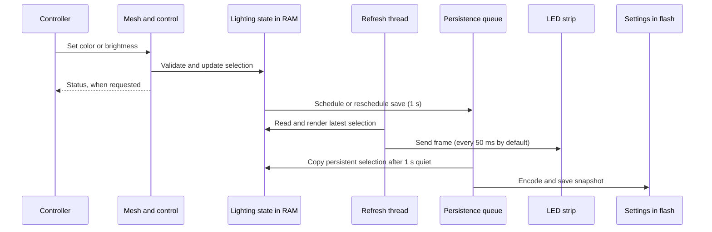
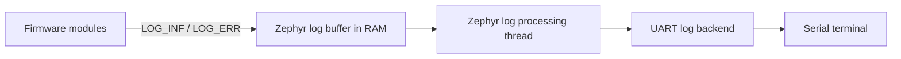

# Meshlight architecture

[Project overview](../README.md) · [Setup and wiring](00-setup.md) · [Lighting API](02-lighting.md) · [Mesh protocol](04-mesh.md) · [Storage](03-storage.md)

This guide focuses on the **firmware running on a light**. The Android app is a
separate controller; it communicates with the firmware over Bluetooth Mesh.

**The short version:** a command changes the requested lighting state in RAM.
A refresh thread sends that state to the LEDs, while a separate worker saves
color and brightness to flash. Zephyr provides the operating system, Bluetooth,
storage, and hardware drivers.

## 1. The big picture

Arrows show the direction of a typical lighting command:

**One board is one mesh node.** It exposes one mesh element regardless of strip
length. Standard OnOff and Level models control the whole strip; a vendor model
also controls individual LEDs and RGB. A phone connects through a mesh proxy;
other mesh nodes can relay messages.

## 2. Who does what?

| Layer or module | Job | Uses |
| --- | --- | --- |
| [Application startup](../firmware/src/main.c) | Starts the modules in a safe order. | Storage, device control, lighting, mesh |
| [Mesh](../firmware/src/mesh/) | Joins the network, receives commands, handles models and transitions. | Zephyr Bluetooth Mesh, lighting, storage, device control for Node Reset |
| [Lighting](../firmware/src/lighting/) | Owns LED state, renders frames, and schedules saves. | Storage, Zephyr LED strip driver, kernel threads and locks |
| [Device control](../firmware/src/device_control/) | Detects the reset button and coordinates factory reset. | Lighting, mesh, storage, GPIO and reboot services |
| [Storage](../firmware/src/storage/) | Wraps access to persistent settings and the reset journal. | Zephyr Settings and its flash backend |
| Zephyr and board configuration | Supply the kernel, Bluetooth, Settings, GPIO and strip drivers; describe pins and devices. | Board hardware and [devicetree overlays](../firmware/boards/) |

The optional developer shell is part of lighting and calls the same lighting
API as mesh control. It is disabled in the default build.

### 2.1. Inside the mesh module

The vendor protocol carries indexed RGB, intensity, and power requests. The
mesh control layer validates and applies them through the lighting API. Board
specific Bluetooth support for the STM32WB lives under `mesh/platform/`.

## 3. Startup: what happens first?

If storage initialization or reset recovery fails, normal mesh startup stops.
Lighting restoration has a separate fallback: missing or invalid lighting data
starts the strip white at 50% intensity. Every LED starts with power on.

## 4. From a tap to light and flash

- A successful command confirms the **requested state in RAM**, not that the
  physical strip showed it or flash has finished saving.
- Changes to color and intensity restart the save delay; power changes do not.
  Power is runtime-only, and LEDs turn on again after reboot.
- A transition can update intermediate brightness values without saving every
  frame. The final value is committed for persistence.
- Rendering applies intensity and gamma correction. Turning an LED off sends
  black but preserves its selection and does not disconnect strip power.

## 5. Threads and work queues

A **thread** runs code. A **work queue** is a thread that runs submitted jobs.
Several jobs can share one queue; a job is not a separate thread.

The table shows the application-owned threads and the Zephyr threads directly
configured by this project. Stack sizes are in **bytes** and are build settings,
not measurements of actual usage. Lower preemptible priority numbers run before
higher numbers when both are ready.

| Thread / queue | What it does and why | Priority | Default stack |
| --- | --- | --- | --- |
| Main | Starts storage, reset recovery, lighting and mesh, then returns. | Zephyr setting `CONFIG_MAIN_THREAD_PRIORITY` | 4096; nRF52: 2048 |
| Reset queue | Journals reset, stops lighting and mesh, then reboots. Its own queue keeps flash/reset work out of button and mesh callbacks. | Preemptible **6** | **4096**, fixed in code |
| Lighting refresh | Renders and sends the latest frame every **50 ms** by default. A dedicated thread keeps strip transfers out of the mesh receive path. | Preemptible **7** | **1536**, configurable |
| Lighting persistence queue | Saves changed RGB/intensity after **1000 ms** quiet; retries failures after **5000 ms**. A private, lower-priority queue keeps flash writes separate from refresh and system work. | Preemptible **8** | **3072**; nRF52: **2048**, configurable |
| Zephyr system work queue | Runs several short delayed jobs listed below, along with SDK work. | Zephyr setting `CONFIG_SYSTEM_WORKQUEUE_PRIORITY` | 4096; nRF52: 2048 |
| Bluetooth receive processing | Receives Bluetooth traffic for the stack. Zephyr and the selected Bluetooth configuration determine its execution context. | SDK/build dependent | `CONFIG_BT_RX_STACK_SIZE`: 5120; nRF52: 3072 |

The priority ordering **6 → 7 → 8** applies to the three application-owned
background threads above. It does not describe every Zephyr or Bluetooth thread.
Priority and stack sizes alone do not guarantee response times; work can also
wait for locks, hardware, or a higher-priority thread.

### 5.1. Jobs on the system work queue

| Job | Trigger and timing | Purpose |
| --- | --- | --- |
| Button handling | GPIO edge; **30 ms** debounce; checks for a hold longer than **30 s** | The interrupt records the edge; the queued job checks the hold and requests reset. |
| Mesh transitions | While a transition is active; rescheduled every **20 ms** | Updates the requested level or power and publishes changes when needed. |
| Health Attention | While identification is active; toggles every **200 ms** | Blinks the board's status LED without changing the strip selection. |

Reset cleanup itself runs on the **private reset queue**, not the system queue.
After a successful lighting initialization, the persistence queue starts once;
the refresh thread also starts if `CONFIG_LIGHTING_AUTO_REFRESH=y`. If automatic
refresh is disabled, the application must call `lighting_apply()`.

### 5.2. How logging works

Meshlight uses **Zephyr's logging subsystem**. Modules such as lighting and mesh
register their own log names and write messages with calls such as `LOG_INF()`
and `LOG_ERR()`. Logging is enabled in [prj.conf](../firmware/prj.conf).

In the inspected standard builds, logging is **deferred**: messages first enter
a shared RAM buffer, then a separate Zephyr logging thread processes them. It is
a logging buffer, not the system work queue or a Meshlight-owned work queue.

This lets the caller leave the slower output processing to the logging thread,
although logging and serial output can still affect timing. The buffer has
limited space: with overflow enabled, old messages can be dropped when it fills.
Logs are diagnostic output, not persistent settings.

| Setting | What it controls |
| --- | --- |
| `CONFIG_LOG_BUFFER_SIZE` | Shared log buffer size. The nRF52 board sets **512 bytes**; STM32WB sets **8192 bytes**. Other builds use their resolved SDK/configuration value. |
| `CONFIG_LOG_PROCESS_THREAD_STACK_SIZE` | Logging thread stack. The inspected nRF52 and nRF54 builds resolve to **768 bytes**. |
| `CONFIG_LOG_PROCESS_THREAD_PRIORITY` | Optional custom priority; without one, Zephyr uses its lowest application thread priority. |
| `CONFIG_LOG_PROCESS_THREAD_SLEEP_MS` / `CONFIG_LOG_PROCESS_TRIGGER_THRESHOLD` | When the thread wakes to process messages. The inspected builds use **1000 ms** and **10 messages**. |

These resolved values can change with the SDK, board, or build configuration;
check the build's `zephyr/.config`. The 1000 ms interval is a processing wakeup
setting, not a promise that every message appears exactly once per second.
Repeated refresh errors are rate-limited to at most once per second, and save
errors use the configured save retry interval, normally five seconds.

With [dev_shell.conf](../firmware/dev_shell.conf), the direct UART log backend
is disabled and the **shell log backend** is enabled. Messages still pass through
Zephyr's log buffer and logging thread, then enter a separate shell log queue for
the shell thread to print alongside commands. In the inspected developer builds,
that queue is **512 bytes** and the shell thread stack is **2048 bytes**. A full
shell queue can delay the logging thread and eventually drop messages; check
`CONFIG_SHELL_BACKEND_SERIAL_LOG_MESSAGE_QUEUE_SIZE` and its timeout in the
generated configuration.

### 5.3. What about other Zephyr threads?

Bluetooth transport and mesh, logging, the idle thread, drivers, and the optional
shell can add SDK-owned threads or queues. Their exact set, priorities, and
stacks depend on the board, SDK, and enabled features. For example, enabling
`dev_shell.conf` adds the serial shell. The nRF5340 build also has separate
Bluetooth network-core firmware; STM32WB uses a separate radio controller.

For the **actual configuration of a build**, inspect its generated
`<build-directory>/zephyr/.config` (for sysbuild, check the application image's
`zephyr/.config`). Useful settings include `CONFIG_MAIN_STACK_SIZE`,
`CONFIG_SYSTEM_WORKQUEUE_STACK_SIZE`, `CONFIG_SYSTEM_WORKQUEUE_PRIORITY`,
`CONFIG_BT_RX_STACK_SIZE`, and `CONFIG_LIGHTING_*`. SDK-created threads and
their settings may differ between builds; the table is not an exhaustive kernel
thread listing. The project defaults are in [prj.conf](../firmware/prj.conf),
[Kconfig](../firmware/Kconfig), and the [board configurations](../firmware/boards/).

## 6. Shared state and reset

| Shared resource | How it is protected | Why it matters |
| --- | --- | --- |
| LED selections and transfers | Lighting mutex | A complete frame and each update are serialized. Separate setter calls can still appear in different frames. |
| Lighting save snapshot | Copied under the lighting mutex; encoded and written after releasing it | Flash I/O does not hold the lighting mutex, so lighting updates and refresh can continue. |
| Mesh control and transitions | Control mutex | Commands and transition updates do not overwrite each other halfway through an operation. |
| Storage wrapper | Storage mutex | Wrapper calls to Zephyr Settings are serialized. |
| Button edge state | Spinlock in the GPIO callback | The interrupt records the state quickly; delayed work handles the rest. |

Factory reset can be requested by the button or a Mesh Node Reset. The reset
queue writes a durable marker, closes lighting control, stops mesh, and reboots.
On the next boot, recovery removes the saved settings and marker before normal
startup, then reboots again. If writing the marker or completing cleanup fails,
the firmware retries rather than silently treating a partial reset as complete.
See [factory reset and recovery](04-mesh.md#6-factory-reset-and-recovery).
