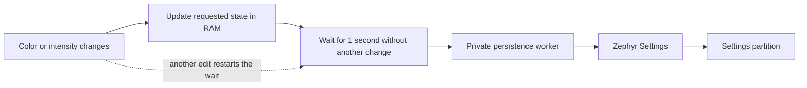

# Storage

[Project overview](../README.md) · [Setup](00-setup.md) · [Architecture](01-architecture.md) · [Lighting API](02-lighting.md) · [Mesh](04-mesh.md) · [Testing](05-testing.md)

## 1. Start here

| Question | Answer |
| --- | --- |
| What is saved? | Each LED's color and intensity. Mesh configuration and keys are also stored in Settings. |
| When is lighting saved? | Automatically, after **1 second without further color or intensity changes**. |
| Is power saved? | **No.** Every LED starts on after a reboot, using its saved color and intensity. |
| What if there is no valid lighting snapshot? | The strip starts **white at 50% intensity**, with power on. |
| What can erase saved data? | A factory reset or full-chip erase. Preserve the Settings partition during normal firmware updates. |

Turning an LED off keeps its color and intensity. Zero intensity still appears
black, even though power starts on after reboot.

## 2. Save scheduling and threading



- **Continuous edits delay the save.** Unchanged values and power-only changes
  do not start or extend the delay.
- **A successful control command confirms RAM state**, not a completed flash
  write. A power cut can lose pending changes.
- A failed save is retried after **5 seconds** by default. The worker copies the
  selection before writing, so flash I/O does not hold the lighting mutex.
- There are no manual lighting save or restore commands. Restore happens at
  startup. For thread settings, see [architecture](01-architecture.md#5-threads-and-work-queues).

The delay and retry are configurable using `CONFIG_LIGHTING_SAVE_DELAY_MS` and
`CONFIG_LIGHTING_SAVE_RETRY_MS` in [firmware/Kconfig](../firmware/Kconfig).

## 3. Flash layout

Each board reserves separate regions for the application and Settings. The map
below shows the layout; sizes vary by board and the drawing is not to scale.

```text
Lower address                                      Higher address
┌────────────────────────────────┬───────────────────────────────┐
│ Application firmware           │ Settings: lighting + mesh     │
│ starts at offset 0             │ includes reset recovery data  │
└────────────────────────────────┴───────────────────────────────┘
```

| Board | Application offset / size | Settings offset / size | Backend |
| --- | --- | --- | --- |
| nRF54L15 | `0x000000` / 1392 KiB | `0x15c000` / 36 KiB | ZMS |
| nRF52832 | `0x000000` / 480 KiB | `0x078000` / 32 KiB | NVS |
| nRF5340 application core | `0x000000` / 992 KiB | `0x0f8000` / 32 KiB | NVS |
| STM32WB55 | `0x000000` / 776 KiB | `0x0c2000` / 32 KiB | NVS |

Offsets are relative to the board's memory device. For STM32WB55, add flash base
address `0x08000000`; its Settings region is `0x080c2000`–`0x080c9fff`.
The nRF5340 network core has separate flash and does not store application Settings.

**Keep the partition layout and backend CRC settings stable across updates.**
All boards use CRC to detect accidental corruption; Settings itself does not
encrypt secrets. A full-chip erase removes lighting and mesh data. Some first
installations need a one-time Settings erase; check the board-specific
[first installation instructions](04-mesh.md#3-first-installation) before erasing.

## 4. Format and compatibility

The lighting snapshot is stored under `meshlight/lighting` as CBOR. It contains
the requested RGB and intensity for each LED, before output processing. Power is
not stored.

| Situation | What happens |
| --- | --- |
| LED count increases | Existing indices are restored; new LEDs start white at 50%. |
| LED count decreases | Matching indices are restored; extra saved entries are ignored. |
| Snapshot is missing or invalid | Lighting uses white/50% defaults without erasing the record. |
| Older version 1 snapshot | It can be read; its saved power field is ignored. A later color or intensity change saves version 2. |
| Downgrade to firmware that only reads version 1 | It cannot read a version 2 snapshot. |

The snapshot limit is **3072 bytes**. The build checks that the configured strip
fits. For the encoding and validation details, see
[lighting_settings.c](../firmware/src/lighting/lighting_settings.c).

## 5. Storage API

The [storage module](../firmware/src/storage/storage.h) wraps Zephyr Settings.
It is mainly used by startup, the lighting save worker, and reset recovery.

| Call | Purpose |
| --- | --- |
| `storage_init()` | Initialize Settings; safe to call again or retry. |
| `storage_store()` | Synchronously write one nonempty value. |
| `storage_restore()` | Read one complete value; returns `-ENOENT` if missing or `-ENOSPC` if the buffer is too small. |
| `storage_load_subtree()` | Load registered settings for a subsystem, such as Bluetooth. |
| `storage_delete()` | Delete one key. |
| `storage_reset_begin()`, `storage_reset_pending()`, `storage_reset_finish()` | Record and complete a recoverable factory reset. |

These calls require thread context and serialize access through the storage
mutex. See the header for argument and error details.

## 6. Manual retention checks

Use a real board and strip for these checks; emulator tests cannot prove hardware
retention or electrical behavior. Start with the [developer shell](02-lighting.md#4-developer-uart-shell).

1. On erased storage, check that the strip starts white at 50%, with power on.
2. Set different colors and intensities on adjacent LEDs. Wait more than one
   second, power-cycle, and check that both selections return.
3. Turn power off, change a selection, wait more than one second, and power-cycle.
   Check that the new selection returns with power on.
4. Change only color, then only intensity. Check that the other property stays
   unchanged and that the final values survive a power cycle.
5. Make rapid changes for more than five seconds. Confirm the save stays pending
   during edits, then stop, wait more than one second, and check the final values
   after a power cycle.
6. Test power cuts during writes: startup should restore a valid snapshot or use
   white/50% defaults without hanging or erasing storage as a recovery action.
7. Flash a normal shell-disabled build without a full erase. Check that the
   selection remains and shell commands are unavailable.

See [physical checks and automated coverage](05-testing.md#6-physical-checks) for the wider test plan.
