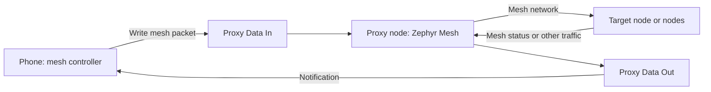

# Bluetooth Mesh control

[Overview](../README.md) · [Setup](00-setup.md) · [Architecture](01-architecture.md) · [Lighting](02-lighting.md) · [Storage](03-storage.md) · [Testing](05-testing.md)

## 1. Start here

Each board is one Bluetooth Mesh **node**, with one mesh element for the whole
strip. It supports 1–339 LEDs, depending on available board memory.


| Want to… | Use |
| --- | --- |
| Add and control a light with a visual interface | [Meshlight Android app](../android-app/README.md) |
| Send individual LED or RGB commands | [Vendor protocol](#4-vendor-protocol-version-1) |
| Remove network and lighting settings | [Factory reset](#6-factory-reset-and-recovery) |

Relay and GATT Proxy are enabled by default. Saved mesh settings are restored
after reboot. An unprovisioned node enables advertising and GATT provisioning
with **No OOB** authentication. Its hardware-derived UUID remains stable across
resets and firmware updates.

## 2. How the GATT proxy works

A phone connects to a proxy node using Bluetooth Low Energy (BLE). The proxy
provides a **GATT service**: a set of named endpoints called characteristics.
These endpoints carry mesh packets between the phone and the mesh network. The
phone can control the connected node and reach other nodes through the network.



For a provisioned node with GATT Proxy enabled, the relevant endpoints are:

| GATT item | UUID | What it does |
| --- | --- | --- |
| Mesh Proxy Service | `0x1828` | Identifies the proxy service the phone connects to. |
| Proxy Data In | `0x2ADD` | The phone writes mesh packets **without a GATT write response**. |
| Proxy Data Out | `0x2ADE` | The node sends packets to the phone using notifications. |
| Data Out CCC descriptor | `0x2902` | The phone enables notifications for Data Out. |

The phone configures a **proxy filter** to select which mesh messages the node
forwards back over the connection. This filter is separate from a model's group
subscriptions. The current firmware allows one simultaneous BLE connection
(`CONFIG_BT_MAX_CONN=1`).

### 2.1. Before and after provisioning

| Node state | GATT service | Data In / Data Out | Purpose |
| --- | --- | --- | --- |
| Unprovisioned | Mesh Provisioning (`0x1827`) | `0x2ADB` / `0x2ADC` | Adds the node to a mesh network over GATT. Data In uses writes without response; Data Out uses notifications. |
| Provisioned, proxy enabled | Mesh Proxy (`0x1828`) | `0x2ADD` / `0x2ADE` | Carries mesh traffic between a connected phone and the network. |

Provisioning over mesh advertising is also enabled. After provisioning, proxy
availability depends on the node's proxy configuration: it is enabled by
default, but saved mesh configuration can change it. Provisioning over GATT and
the proxy feature are separate settings.

**GATT characteristics are not mesh elements.** Meshlight has one mesh element
containing the Configuration, Health, Generic OnOff, Generic Level, and vendor
models. The proxy characteristics transport mesh messages; they are not direct
RGB or brightness controls. The mesh models handle those commands after they
reach the node.

## 3. First installation

1. Prepare the SDK, wire the strip, and flash the board using [setup](00-setup.md).
2. Check the board-specific notes below. Then power on the board.
3. Add the light using the [Android app](../android-app/README.md#use-the-app).

You can also provision the light with nRF Mesh and subscribe it to a group for
group control.

### 3.1. STM32WB55: first installation

- The board needs ST's **extended HCI-only CPU2 firmware**
  `stm32wb5x_BLE_HCILayer_extended_fw.bin` from STM32CubeWB v1.23.0. Install it
  using STM32CubeProgrammer and ST's
  [controller release notes](https://github.com/STMicroelectronics/STM32CubeWB/blob/v1.23.0/Projects/STM32WB_Copro_Wireless_Binaries/STM32WB5x/Release_Notes.html).
  CPU2 is not built by this project. The tested binary's SHA-256 is
  `AB3356BB561BB5407F214A3797D42FFCDABA72A761BD8C52E9DD473BE9B9D215`.
- For the **first mesh installation**, after flashing CPU1, erase only the
  Settings area, then reset the board. Its absolute range is
  `0x080C2000`–`0x080C9FFF`: 4 KiB pages **194–201 inclusive** in
  STM32CubeProgrammer CLI. Check the generated `zephyr.dts` before erasing.
  Existing lighting and mesh settings there will be lost.
- Ordinary firmware updates should preserve Settings and CPU2; do not mass
  erase the device. The board's SDK corrections are enabled by default; review
  them when upgrading the SDK. For ST-LINK UART, fit JP5 TX/RX jumpers.

### 3.2. nRF54L15: moving from `onoff-app`

If the board previously ran `onoff-app`, erase its Settings partition **once**
before the first CRC-enabled Meshlight installation. The old format is
incompatible and a logical Node Reset may not clear it. This removes saved
settings and requires provisioning again.

After checking the generated layout, use an SDK terminal and the board's debugger
serial number. The backup contains private network state:

```powershell
nrfutil device halt --serial-number <SERIAL>
nrfutil device read --serial-number <SERIAL> --address 0x15C000 --bytes 36864 --to-file settings-before-mesh.hex
nrfutil device erase --serial-number <SERIAL> --pages 0x15C000-0x165000
west flash -d <BUILD_DIRECTORY> --dev-id <SERIAL>
```

The erase end address is exclusive. Keep the Settings layout and CRC options
unchanged on later updates; normal flashing should preserve provisioning.

## 4. Vendor protocol version 1

Use this section when sending raw messages, for example through nRF Mesh.
The app accepts a one-byte opcode and adds the company ID. Multi-byte values
are **little endian**; RGB is always in logical R, G, B order.

The default company ID `FFFF` is a development placeholder; the default model
ID is `0001`. Configure them with `CONFIG_MESHLIGHT_COMPANY_ID` and
`CONFIG_MESHLIGHT_MODEL_ID`, and assign the project's company ID before distribution.

| Opcode | Operation | Parameters in wire order |
| --- | --- | --- |
| `C0` | Capabilities Get | Empty |
| `C1` | Capabilities Status | `version:u8`, `led_count:u16`, `features:u16`, `max_intensity:u8` |
| `C2` | State Get | `target:u16` |
| `C3` | State Set, acknowledged | `target:u16`, `tid:u8`, `flags:u8`, optional RGB, optional intensity |
| `C4` | State Set, unacknowledged | Same parameters as `C3` |
| `C5` | State Status | `target:u16`, `result:u8`, `flags:u8`, `r:u8`, `g:u8`, `b:u8`, `intensity:u8` |

**Target:** `0000` through `led_count - 1` select one zero-based LED; `FFFF`
selects all LEDs on each receiving node. `FFFF` is a vendor target, not a mesh
destination address.

**Set flags:** combine the properties to change. Omitted properties stay the same.

| Bit | Meaning |
| --- | --- |
| 0 | Include RGB: three bytes, each 0–255. |
| 1 | Include intensity: one byte, 0–100, after RGB if present. |
| 2 | Change power. |
| 3 | Power is on; valid only when bit 2 is set. |
| 4–7 | Reserved; set to zero. |

Set at least one property bit. Use a new transaction ID (TID) for each edit;
matching retries within six seconds are treated as duplicates. An acknowledged
retry still receives status. For repeated or group updates, `C4` avoids a
response from every node.

### 4.1. Try these messages

| Action | Opcode | Hex parameters |
| --- | --- | --- |
| Get capabilities | `C0` | Empty |
| Read LED 0 | `C2` | `0000` |
| Read the whole strip | `C2` | `FFFF` |
| Set LED 0 red; keep intensity and power | `C3` | `00000101FF0000` |
| Set all LEDs blue at 25%, power on | `C3` | `FFFF020F0000FF19` |
| Turn LED 0 off; keep color and intensity | `C3` | `00000304` |
| Turn LED 0 on | `C3` | `0000040C` |
| Set all intensities to 50% | `C3` | `FFFF050232` |

TIDs in these examples are illustrative: change the TID when making a new edit.
Use opcode `C4` for an unacknowledged Set, regardless of the phone UI's
acknowledgement checkbox.

<details>
<summary>How to read status messages</summary>

- Result: `0` success, `1` bad target, `2` bad request, `3` unavailable.
  State bytes are zero on error.
- State Status flags: bit 0 is power on; bits 1–3 indicate mixed RGB, intensity,
  and power. For the whole strip, RGB comes from LED 0, intensity is the rounded
  average, and power is on if any LED is enabled.
- Capability bits 0–5 indicate RGB, intensity, power, individual targets,
  all-LED targeting, and mixed-state reporting. Current firmware returns `003F`.
- A six-LED node reports capabilities `0106003F0064`. The blue/25% example above
  returns State Status `FFFF00010000FF19` on success.

</details>

## 5. Transitions and persistence

- Standard OnOff and Level support optional delays and transitions; omitted
  timing means an immediate change. Level also supports Delta and Move.
- Vendor RGB updates are immediate. Conflicting vendor edits interrupt the
  relevant transition; local lighting edits supersede active mesh transitions.
- Color and intensity save after **1 second without further edits**. Power is
  runtime-only: after reboot, LEDs start on with their saved selections.
- An acknowledgement confirms the requested state in RAM, not a completed strip
  transfer or flash write. See [storage](03-storage.md) for details.

## 6. Factory reset and recovery

Choose either reset method:

- Hold **button 0 for more than 30 seconds**. On the Nucleo, `sw0` is SW1.
- Send **Node Reset** from the controller, such as nRF Mesh.

Both clear lighting and mesh settings. After reset, the strip starts white at 50%
with power on and the node is available for provisioning. After a physical
reset, remove the stale node from the phone's database before adding it again.

Reset is journaled: the node records the reset, stops control, reboots, clears
Settings, and reboots again. If cleanup is interrupted, it resumes on boot before
normal mesh startup. Reset does not erase the application or CPU2 firmware.
More detail: [architecture and reset](01-architecture.md#6-shared-state-and-reset).

## 7. Hardware acceptance checklist

Automated tests do not establish radio or electrical behavior. On the target
boards and strip, check:

- Provisioning, model binding, RGB, individual LEDs, OnOff, Level, and transitions.
- Settings after a power cycle, both reset methods, reprovisioning, and stable UUID.
- Relay operation with endpoints that cannot communicate directly; compare relay
  enabled and disabled runs.
- Output, timing, and power on the actual long strip.

See [testing](05-testing.md) for the wider test plan. OOB authentication,
animation streaming, and bulk frame upload are outside the current scope.
